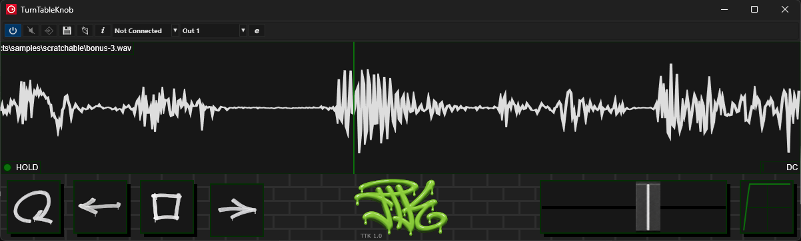

# Turn Table Knob :minidisc:

VST3 audio time scrubbing plugin

#### Import
Simply grab the binary from *Releases* and put it somewhere your DAW can see it. The only available version is a 64-bit x86 Windows DLL (`.vst3` extension).

#### Quick start
- Select an audio sample; supported file types: `.wav`, `.mp3` and `.flac`
- Drag the playhead around to produce sounds
- Try the auto-play controls: repeat, back, stop, play
- Mouse scrolling moves the sample
- Mouse scrolling with CTRL down zooms the sample
- The X-Fader slider is basically a gain control (0% on the left, 100% on the right)
- The transfer curve of the x-fader can be adjusted for a sharper response
- Try recording the VST parameters in your DAW
- `Playhead` automation only applies when `Hold` is on

#### Compile it?
Nope. At least not without the VST3 SDK (not included, sorry). If you really feel like trying, follow the tutorials here: https://steinbergmedia.github.io/vst3_dev_portal/pages/index.html
